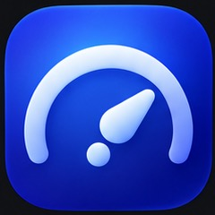
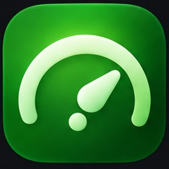
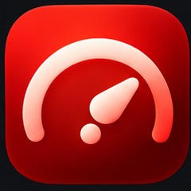
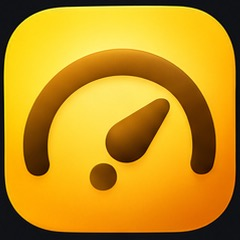
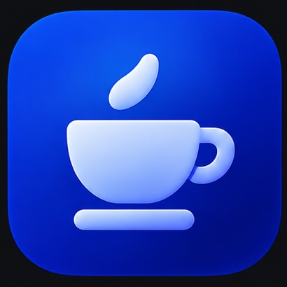

# Cruise Control

Developer release UI: run `python3 scripts/dev-console.py --start` to open the persistent local console, or `python3 scripts/dev-console.py` for foreground operation. See [Developer console](DEVELOPER_CONSOLE.md) for build history, logs, owner-only drafts and macOS permission setup.



**A clear goal. A steady workflow.** A native Mac companion for HeyClicky and VS Code: organize agent tasks, define Done, review progress, and choose what happens next.

**[Download for Mac](https://github.com/ilovespectra/CruiseControl/releases/latest/download/CruiseControl.pkg)** · **[Full feature guide](https://cruise.kolektivkrog.si/docs.html)** · **[Release notes](https://github.com/ilovespectra/CruiseControl/releases/latest)** · **[Contribute](CONTRIBUTING.md)**

   

## What Cruise does

| Feature | Your controls |
| --- | --- |
| **Task workspace** | HeyClicky jobs and VS Code sessions, project cards or individual tasks, search, filters, sorting, and project/task priorities. Ollama suggests project groupings from thread-linked chats, paths and repositories; you can correct them. |
| **Define Done** | Save a goal per task with Markdown preview and document import. Compare the latest response with your criteria and supporting evidence. |
| **Auto-bump** | Review fresh reports and send follow-ups for explicitly opted-in tasks. Confirm the workspace and build/branch/finishing choices first, then choose automatic rounds or one-time Generate and Send. Set continuation policies for time, credit and message limits. |
| **Independent review** | Let local Ollama assess tasks while auto-drive and approvals are off. Keep drafts for review, or enable chat-only delivery with per-task Auto-bump. |
| **Drive modes** | Manual leaves HeyClicky drive prompts to you; Rest declines them and pauses Done-based sending; Cruise approves them when driving is enabled. |
| **VS Code approvals** | Optional Ollama-reviewed tool approvals across windows, separate file-metadata and Pylance/provider session-grant opt-ins, and Review / Allow all / Hold policies for URL fetches. |
| **Model & usage controls** | Economy-model preference, progress checks, confirmed escalation, waiting-session alerts with optional sound, and a usage cutoff based on visible usage information. |
| **Storage** | Inspect caches, support data and workspaces by size, age and task. Confirm cleanup of exact agent-thread build folders or disposable `.build` / `node_modules` subfolders while preserving source and shared history. |
| **Notch dashboard** | Blue, green, red and yellow app themes, a Rest coffee cup, pill positioning and visibility, control-activity glow/banner, independent HeyClicky/VS Code audio controls, and a Pride Pong break from the app menu. |
| **Updates & diagnostics** | Cruise release checks, a separate HeyClicky update option, persistent task/delivery state, activity logs and delivery diagnostics. |

This guide covers current source; [release notes](https://github.com/ilovespectra/CruiseControl/releases/latest) list changes in each published build. Latest: [](https://github.com/ilovespectra/CruiseControl/releases/latest).

## Get started

Requires **macOS 14 or later**.

1. [Download and open the installer](https://github.com/ilovespectra/CruiseControl/releases/latest/download/CruiseControl.pkg).
2. Grant **Accessibility** in System Settings → Privacy & Security. Screen Recording is optional for visual HeyClicky prompt detection.
3. Open the notch dropdown and Settings. Start in **Manual**, confirm a task workspace, and define Done.
4. Review the result, then enable only the automation options you want.

Packages are currently unsigned and not notarized; review macOS installation warnings rather than disabling system protections.

> **Automation essentials:** auto-approval lets agents change files, access data and use paid services without asking each time. Keep backups and supervise sensitive work. Ollama reviews and usage guards are workflow aids, not a security sandbox or billing cap.

## How task follow-ups work

HeyClicky and VS Code share Done editors, report cards, and review/respond controls. VS Code background thread inspection runs on launch and every five minutes only for eligible tasks with explicit Auto-bump enabled; Done alone never authorizes switching threads. Approval polling reads currently exposed requests without opening other threads. Automatic model changes also require Auto-bump on that chat. **Examine/Review** holds its assessment for you and may explicitly open the selected task. **Generate and Send** is a one-time action; **Auto-bump** opts that task into automatic follow-ups.

Before drafting or sending, confirm the folder and complete **Build, branches & finishing**: delivery, branch organization, work branch, and whether to merge into that branch. HeyClicky also requires a build-location choice; VS Code builds in its workspace. Missing choices are highlighted. These preferences guide the agent’s work.

Auto-bump works in Manual or Cruise and pauses in Rest. It follows current-report checks, user-stop holds, duplicate prevention and per-definition round limits, rather than generic nudge cooldowns. Follow-ups are tied to the exact task and verified against its transcript. Uncertain sends remain pending; set-aside messages appear in Activity → Diagnostics for seven days and are not resent from that archive.

With no Auto-bump tasks enabled, automatic checkups do not switch VS Code threads, raise its approval windows, or hover HeyClicky's notch. Cruise still reads exposed approval controls and can press them through Accessibility without opening another thread.

Choose **Settings → App & permissions → Appearance & startup → Color theme** for Red, Yellow, Blue (default), or Green. The saved theme updates mode icons, dashboard lights, driving illumination and shared interface accents immediately. Cruise and Rest use the supplied artwork with transparent rounded edges; Manual retains its themed button-press symbol. Mode buttons are icon-only with accessible names and tooltips. Warning/error colors and the Pride game's rainbow remain semantic rather than themed.

On first run (no existing Cruise configuration), Cruise imports HeyClicky's saved Cursor color from `overlayCursorColorHex` when it maps to a supported theme. Missing, neutral, or unsupported values keep Blue. Existing Cruise choices are never changed automatically. Launch with `--import-heyclicky-theme` only to explicitly reimport the current HeyClicky preference once.

In Cruise mode, VS Code requests rejected by the safety reviewer enter a single review queue. Cruise warns before navigating, highlights the request's Allow control without pressing it, and pauses routine thread-changing automation. Another queued rejection never displaces the current request. A hidden/unreadable prompt is not treated as a decision; the queue advances only after resolution is observed. Manual/Rest hide the guide. HeyClicky drive-consent prompts currently have no command-level safety reviewer and are not classified as safety-rejected requests.

Brand PNGs are SwiftPM resources, included in both regular and local app bundles. To regenerate them from the supplied originals in `marketing/logos`, run `python3 scripts/prepare-brand-icons.py` with Pillow available. Extraction removes the neutral backdrop/labels without recoloring the artwork. Theme anchors are exact sRGB samples from the gauge originals, documented in `ColorTheme.swift`.

Packaged icons load explicitly from `Contents/Resources/CruiseControl_CruiseControl.bundle` using PNG URLs, not named-image lookup. Run the app executable with `--validate-brand-icons` to verify all eight images decode from its resource bundle.

Drive mode alone does not enable messaging. Legacy generic stall, interruption and relaunch nudges are replaced by Done-based follow-ups. For the full workflow, see the [task guide](https://cruise.kolektivkrog.si/docs.html#tasks).

## Stay in control

Cruise announces chat switches and input with a blue screen-edge glow and banner. Automatic VS Code switches give 1.5 seconds’ notice and defer when you start typing; the previous chat is restored after reading. Passive reads of the selected chat stay quiet.

Choose **Manual** to pause driving, **Rest** to decline HeyClicky drive prompts and pause Done-based sending, or **Quit / Cmd+Q** to stop Cruise and unload its restart service for the login session. Hiding the notch leaves Cruise running. Stop already-running agents in their own app.

Settings, history and delivery state stay on your Mac. Ollama is local by default; a remote endpoint receives the conversation content used for reviews. See [permissions and privacy](https://cruise.kolektivkrog.si/docs.html#privacy).

## Build and run locally

With Xcode Command Line Tools installed (`xcode-select --install`):

```sh
swift test
./scripts/run-local.sh
```

This incrementally builds and launches `build/local/Cruise Control Local.app`, with a separate app identity and settings in `build/local-state`. It leaves `/Applications` and production builds unchanged. The local app is labeled **1.1.2 (local testing)**; override with `CC_LOCAL_VERSION`.

In VS Code, use **Run Build Task** (Cmd+Shift+B) or **Cruise: Run local checkout (no install)**; **Cruise: Run Swift tests** runs the suite. Stop the running task before relaunching after edits.

For an installable bundle, run `./scripts/build-app.sh`. Use `--install` for a user-owned app, or the packaged installer for an administrator-owned app. Use `--uninstall` to remove the app and login agent; saved configuration remains.

Website checks:

```sh
node --test Tests/site/*.test.mjs
```

The [landing page and guide](https://cruise.kolektivkrog.si) use the supplied gauge and coffee-cup artwork, with four accent palettes and System/Light/Dark appearance. Browser theme choices are separate from app settings.

## Contribute

Start with [CONTRIBUTING.md](CONTRIBUTING.md), then [open an issue](https://github.com/ilovespectra/CruiseControl/issues) or submit a focused pull request. Include relevant tests and redact private information from logs.

Maintainers: [Publisher console and release workflow](DEVELOPER_CONSOLE.md).

Independent open-source software; not affiliated with HeyClicky, VS Code or GitHub.
